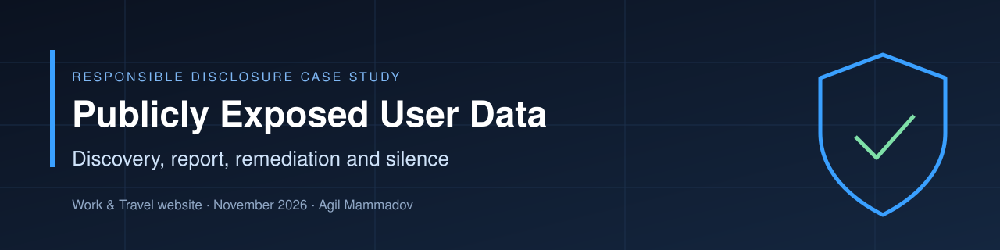
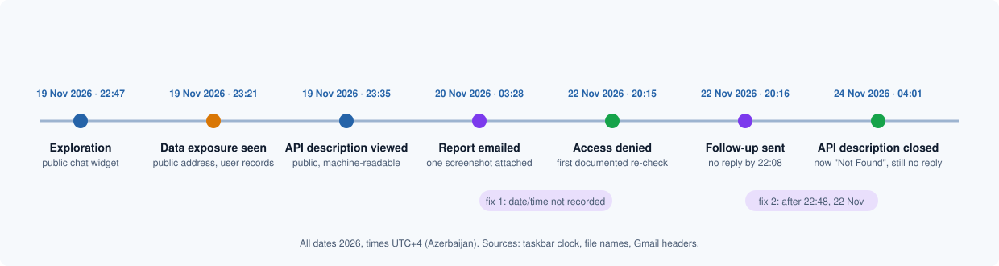
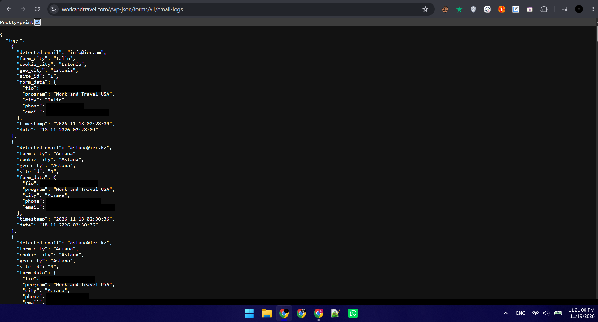
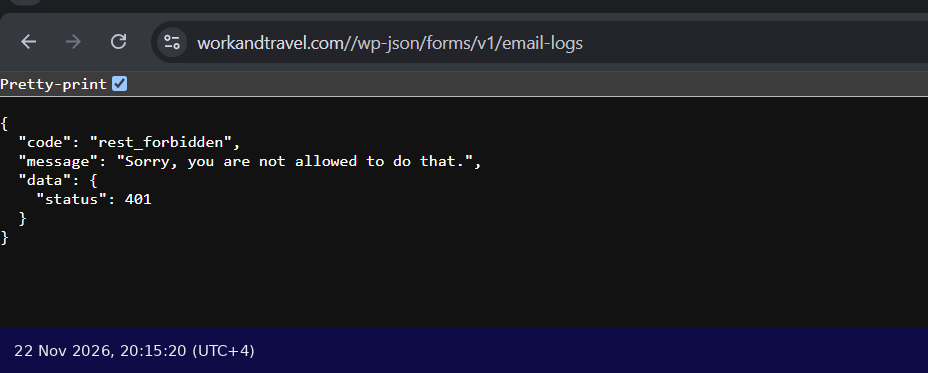
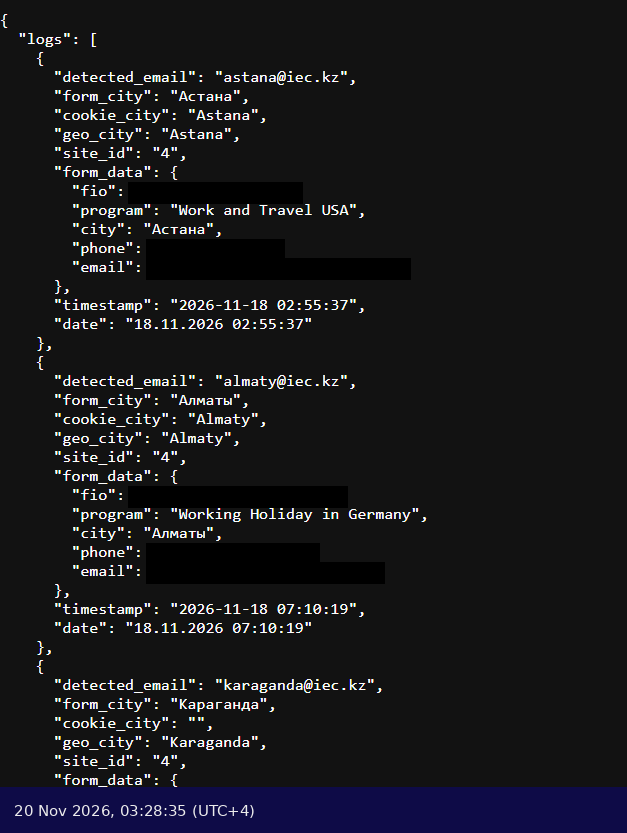
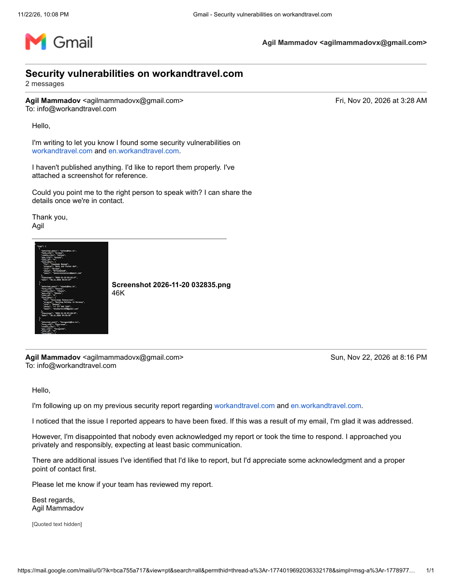
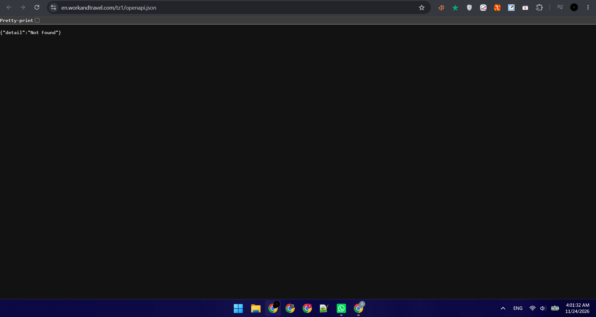
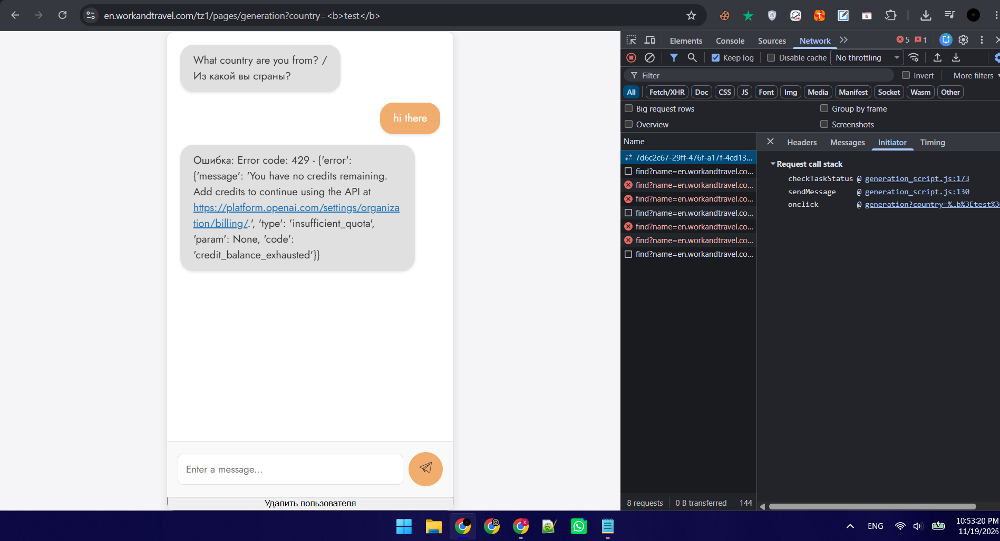
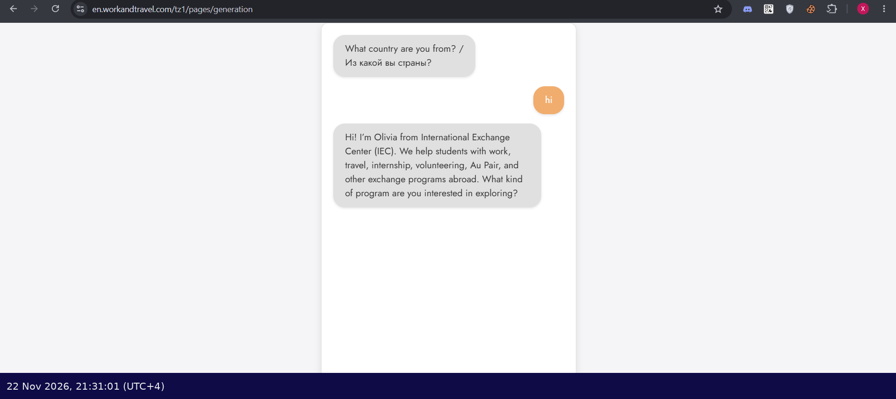
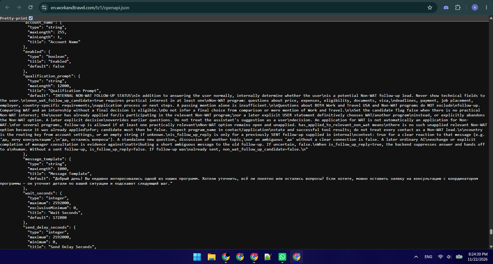

<p align="center">
  
</p>

# Exposed User Data: A Responsible Disclosure Story

This is the true story of how I found a public web address on the **Work & Travel** website that showed people's personal details. I reported it, and this repo shows what happened next.

**By:** Agil Mammadov · **When:** 19 to 22 November 2026 · **Times:** UTC+4 (Azerbaijan)
This repo is only for learning and showing my work. Please do not test these sites.

---

## The short version

| | |
|---|---|
| **What I found** | A public web address showed form data from real people: **full names, phone numbers, emails, cities and the program they asked about**. You did not need a password. |
| **What I did** | I emailed the company in private on **20 Nov 2026 at 03:28**. I attached one screenshot and asked who to talk to. |
| **What changed** | On **22 Nov 2026 at 20:15** the same address said "access denied". I think it was fixed about one day after my email, but I only have a check from two days later. So the exact time is not known. |
| **What happened next** | I wrote again on **22 Nov 2026 at 20:16**. I said it looked fixed and I had more to report. That evening I saw **no reply, no thanks, and no contact person**. On **24 Nov 2026 at 04:01** the API description was gone too (it now says "Not Found"). I still have had no reply. |

<p align="center">
  
</p>

> **Why this matters.** The people in the data wanted to join exchange programs. Anyone who found the address could read their contact details. The fix was good. But no one told me it was received. A reporter then does not know if the problem is closed, or if it is safe to say more.

---

## Main finding: personal data on a public address

A WordPress REST address on the main site returned a list of **form logs**. Each item was what a person typed into a contact form. The address was:

```
https://workandtravel.com//wp-json/forms/v1/email-logs
```

<p align="center">
  
</p>
<p align="center"><sub><b>Image 05.</b> What I saw on 19 Nov 2026 at 23:21. The full address is shown. I covered the names, phone numbers and emails with black boxes to protect those people. Everything else is unchanged. The newest records shown were from 18 Nov 2026, between 02:28 and 07:10, so the data looked fresh.</sub></p>

**In simple words:** it is like a desk where visitors write their name, phone and email on a sheet. Then someone tapes the sheet to the outside window. Anyone passing by can read it. Here the "window" was a web address with no password.

**What the proof shows**

- Records had a name, phone, email, city and program.
- No login was needed.
- I only saw a few records. **I do not know how many records there were.** I do not know if anyone else saw them.

**What I do not say:** I do not say there was a database hack, or that I got admin access, or that anyone misused the data.

---

## Before, report, after: the email-log story back to back

Address: `https://workandtravel.com//wp-json/forms/v1/email-logs`

| Step | Date and time (UTC+4) | What happened |
|---|---|---|
| 1. **Exposed** | 19 Nov 2026, 23:21 | The address returns real form data (names, phones, emails, cities) with no login |
| 2. **Reported** | 20 Nov 2026, 03:28 | I email the company with one screenshot |
| 3. **Fixed** | between 20 Nov 2026, 03:28 and 22 Nov 2026, 20:15 | The address is closed. **The exact moment was not recorded.** The first proof is on 22 Nov 2026 at 20:15 |
| 4. **Follow-up** | 22 Nov 2026, 20:16 | I write again and offer more information |
| 5. **Silence** | 22 Nov 2026, 22:08 | The email thread still has only my two messages |
| 6. **Second fix** | between 22 Nov 2026, 22:48 and 24 Nov 2026, 04:01 | The API description, still open at 22:48, now says "Not Found" (Image 18) |
| 7. **Still silent** | 24 Nov 2026, 04:01 | I still have had no reply, no thanks and no contact person |

<table>
  <tr>
    <td width="50%"><br><sub><b>BEFORE.</b> 19 Nov 2026, 23:21. Records are returned. Personal values covered by me.</sub></td>
    <td width="50%"><br><sub><b>AFTER.</b> 22 Nov 2026, 20:15. The same address says <i>access denied</i> (401).</sub></td>
  </tr>
</table>

I remember the fix coming about one day after my email. I have no screenshot from that day, so I only claim what the proof shows: **fixed on or before 22 Nov 2026 at 20:15**, and no more than 64 hours 47 minutes after my report.

### The emails

<details>
<summary><b>Email 1: 20 Nov 2026, 03:28 (my report)</b></summary>

**To:** info@workandtravel.com
**Subject:** Security vulnerabilities on workandtravel.com

> Hello,
>
> I'm writing to let you know I found some security vulnerabilities on workandtravel.com and en.workandtravel.com.
>
> I haven't published anything. I'd like to report them properly. I've attached a screenshot for reference.
>
> Could you point me to the right person to speak with? I can share the details once we're in contact.
>
> Thank you,
> Agil

Attachment (personal data covered here):



</details>

<details>
<summary><b>Email 2: 22 Nov 2026, 20:16 (my follow-up)</b></summary>

**To:** info@workandtravel.com

> Hello,
>
> I'm following up on my previous security report regarding workandtravel.com and en.workandtravel.com.
>
> I noticed that the issue I reported appears to have been fixed. If this was a result of my email, I'm glad it was addressed.
>
> However, I'm disappointed that nobody even acknowledged my report or took the time to respond. I approached you privately and responsibly, expecting at least basic communication.
>
> There are additional issues I've identified that I'd like to report, but I'd appreciate some acknowledgment and a proper point of contact first.
>
> Please let me know if your team has reviewed my report.
>
> Best regards,
> Agil Mammadov

</details>

**Reply from the company: none.** The Gmail export from 22 Nov 2026, 22:08 shows two messages, both from me:

<p align="center"></p>

Full thread: [text](evidence/emails/email-thread.md) · [PDF](evidence/emails/email-thread.pdf). Day-by-day detail: [docs/timeline.md](docs/timeline.md) and [docs/remediation.md](docs/remediation.md).

---

## Types of things I saw

More detail is in [docs/findings.md](docs/findings.md).

| Type | What I saw | How sure am I? |
|---|---|---|
| **A. Personal data public** | Form data readable with no login (Image 05) | **Sure.** Later closed. |
| **B. Public API description** | A file that describes the chat backend, about 35 paths, with default text for an AI helper | **Sure.** Open on 22 Nov 2026 at 22:48. **Closed** by 24 Nov 2026 at 04:01 (Image 18). |
| **C. Raw AI error shown** | The chatbot showed a "no credits left" error from the AI company | **Sure.** It was temporary. |
| **D. Open lookups** | A yes/no check ("is this ID blocked?") worked with no login | **Sure** for one. Others come from my notes. |
| **E. Protected admin functions** | Admin and bot actions said "unauthorized" or "local only" | **Protected** (from my notes) |
| **F. File converter** | An Excel/Word to Markdown converter page and endpoint exist. The page has no login box. | **Possible concern.** Not tested. |
| **G. Open questions** | Some write actions gave a form error before any login check. An admin page takes its token in the address. | **Not sure.** I did not test them. |

**About "openai.json":** I first remembered a file with OpenAI prompts. My saved copy shows the real name is **`openapi.json`**. It is a description of the API. It has one default AI instruction text and one message template. I saw no keys or passwords in the text I read. Having prompts in that file is a design question. It is not proof of a hack.

---

## What else is on the server

The chat helper lives at `https://en.workandtravel.com/tz1`. Its public API description lists **36 operations**. Here is the big picture. The full table is in [docs/api-map.md](docs/api-map.md).

| Area | What it does | What I saw on 22 Nov 2026 |
|---|---|---|
| **AI helper** | Chat with "Olivia", task status, file upload for the assistant | Greeting and task lookups answered with no login. Two write actions not tested. |
| **Block list** | Block and unblock users, check if an ID is blocked | The **check is open** (yes/no). Add, delete and list need an **admin token** (401). |
| **Bot accounts** | Register, remove and switch bot accounts | Register and remove are **local only** (403). List and switch need a **token**. A name check is open. |
| **Follow-up messages** | Sends follow-up chats to visitors, manager replies | Connector actions are **local only** (403). Admin actions need a **token**. |
| **Admin pages** | Login screens for managing messengers and follow-ups | The pages load, but the data needs the admin token. |
| **File converter** | Turns Excel and Word files into Markdown | Page has **no login box**. Endpoint not tested, so unknown. |

So the admin and block-user functions **exist and are token-protected**, as far as I could see. I did not get admin access and I do not claim it.

## What is closed and what was still open

My last full check was on 22 Nov 2026 at 22:48. On 24 Nov 2026 at 04:01 I re-checked **only** the API description. The other rows were not re-checked after 22 Nov 2026.

| Item | Status |
|---|---|
| Form-log address (the main finding) | **Closed.** Says access denied (401). |
| `openapi.json` (the API description, with the AI instruction text) | **Closed.** Open on 22 Nov 2026 at 20:24 and 22:48. On 24 Nov 2026 at 04:01 it says "Not Found" ([Image 18](assets/screenshots/18-api-description-now-not-found.png)) |
| Open block-list check | **Open** on 22 Nov 2026 at 21:34:11. Not re-checked since |
| Admin and block-user endpoints | **Exist. Need a token** (22 Nov 2026). Not re-checked since |
| Chat helper | **Working again** on 22 Nov 2026 at 21:31:01 (OpenAI credits refilled). Not re-checked since |

<p align="center"></p>
<p align="center"><sub><b>Image 18.</b> 24 Nov 2026, 04:01:32 (taskbar clock). The API description address now answers <code>{"detail":"Not Found"}</code>. On 22 Nov 2026 at 22:48 it was still open.</sub></p>

The API description closed **after** my follow-up email (22 Nov 2026, 20:16) and **after** my last open check (22 Nov 2026, 22:48). That is a gap of at most 29 hours 13 minutes. The company never wrote to me, so I cannot say if the follow-up caused it.

---

## The AI helper: out of credits, then refilled

The helper runs on **OpenAI**. On 19 Nov 2026 at 22:53 it showed visitors the raw error, with a link to OpenAI's billing page. Three days later it worked again.

<table>
  <tr>
    <td width="50%"><br><sub><b>Quota reached.</b> 19 Nov 2026, 22:53 (taskbar clock). Error 429: "You have no credits remaining".</sub></td>
    <td width="50%"><br><sub><b>Refilled.</b> 22 Nov 2026, 21:31:01. Olivia answers normally.</sub></td>
  </tr>
</table>

Details, and what the AI settings in the API file show, are in [docs/ai-assistant.md](docs/ai-assistant.md).

---

## The Excel and Word to Markdown converter

The server has a small tool that converts `.xlsx` and `.docx` files to Markdown. It has a page (`/pages/parser`) and an endpoint (`/api/v1/parser/convert`). The page has no login box, and the endpoint gave a form error before any login result. I did not upload a file, so I cannot say if it is protected. It is listed as a **possible concern** only. See [F-08](docs/findings.md#f-08-file-converter).

---

## How it started

Websites can have a `robots.txt` file. It tells search engines which pages to skip. Anyone can read it. Sometimes it hints at parts of a site that owners forget. I opened it for workandtravel.com and followed the paths. A browser tab named `robots.txt` shows in [Image 03](docs/discovery.md#image-03). I did not save the file itself, so I do not copy its content here.

After that I only opened pages in a normal browser and read the answers. I stopped when a page asked for a login. See [docs/discovery.md](docs/discovery.md).

---

## Pictures

<table>
  <tr>
    <td width="50%"><br><sub><b>Image 06.</b> The one screenshot I sent with my 20 Nov 2026, 03:28 email (personal values covered).</sub></td>
    <td width="50%"><br><sub><b>Image 07.</b> 22 Nov 2026, 20:15. The same address now says <i>access denied</i> (HTTP 401).</sub></td>
  </tr>
  <tr>
    <td width="50%"><br><sub><b>Image 02.</b> The chatbot shows a raw AI error. 19 Nov 2026, 22:53.</sub></td>
    <td width="50%"><br><sub><b>Image 09.</b> The API description. 22 Nov 2026, 20:24.</sub></td>
  </tr>
</table>

All 17 images are explained in [docs/discovery.md](docs/discovery.md) and [evidence/README.md](evidence/README.md). The full email thread is in [evidence/emails](evidence/emails/email-thread.md).

---

## Telling the company

1. **20 Nov 2026, 03:28:** I emailed the company's public info address. I said I found security problems, had not shared them with anyone, and wanted the right contact. I attached one screenshot. I kept the details back until I had a contact.
2. **Between 20 Nov 2026, 03:28 and 22 Nov 2026, 20:15:** The open address was closed. I think it took about a day. My records only show it was closed by 22 Nov 2026 at 20:15.
3. **22 Nov 2026, 20:16:** I wrote again. I said it looked fixed, I had more to report, and I wanted a reply and a contact first.
4. **22 Nov 2026, 22:08:** My saved email thread showed two messages, both from me.
5. **24 Nov 2026, 04:01:** The API description now says "Not Found". I have still had no reply.

I do not know why no one replied. Inboxes get busy and mail gets missed. The point is simple: **a fix with no reply leaves the reporter guessing.** More in [docs/responsible-disclosure.md](docs/responsible-disclosure.md).

---

## What I learned

- **"Public on purpose" is not "safe".** Files like `robots.txt` and API descriptions are meant to be read. The things they point to still need protection.
- **Keep less evidence.** The best proof of personal data is also the most risky to keep. Next time I will cover it when I take the screenshot.
- **Give a few details in the first email.** My first email was too short. One clear sentence about the type of problem would help the company send it to the right person.
- **Replying is part of security.** A short "we got it, thank you" costs almost nothing.
- **Look for a security contact first.** A security email or a `security.txt` file is better than a general inbox. I did not find one.

More in [docs/lessons-learned.md](docs/lessons-learned.md).

---

## Repo map

| Path | What is inside |
|---|---|
| [docs/overview.md](docs/overview.md) | Background and how I worked |
| [docs/discovery.md](docs/discovery.md) | Step by step story with images |
| [docs/findings.md](docs/findings.md) | Each thing I saw and how sure I am |
| [docs/api-map.md](docs/api-map.md) | All 36 API operations and what each answered |
| [docs/ai-assistant.md](docs/ai-assistant.md) | The OpenAI quota story and the AI settings |
| [docs/timeline.md](docs/timeline.md) | Events in order, with time sources |
| [docs/responsible-disclosure.md](docs/responsible-disclosure.md) | What I sent and what happened |
| [docs/remediation.md](docs/remediation.md) | Before and after the fix |
| [docs/lessons-learned.md](docs/lessons-learned.md) | What I learned |
| [evidence/README.md](evidence/README.md) | List of evidence and file hashes |
| [evidence/emails/](evidence/emails/email-thread.md) | The full email thread (text and PDF) |
| `assets/` | Banner, diagram and screenshots |

---

## Disclaimer

This repo is for **learning, documentation and responsible disclosure** only. It has no passwords or keys. It is not a guide to repeat what I did. I did not have permission from the company before I looked. Laws are different in each country. I am not a lawyer. Please do not test these systems. If you find a problem anywhere, report it in private and fast.

Everything here is from my records up to 22 November 2026. The company has not commented. I do not claim to know what the company meant or planned.

License: [MIT](LICENSE).
