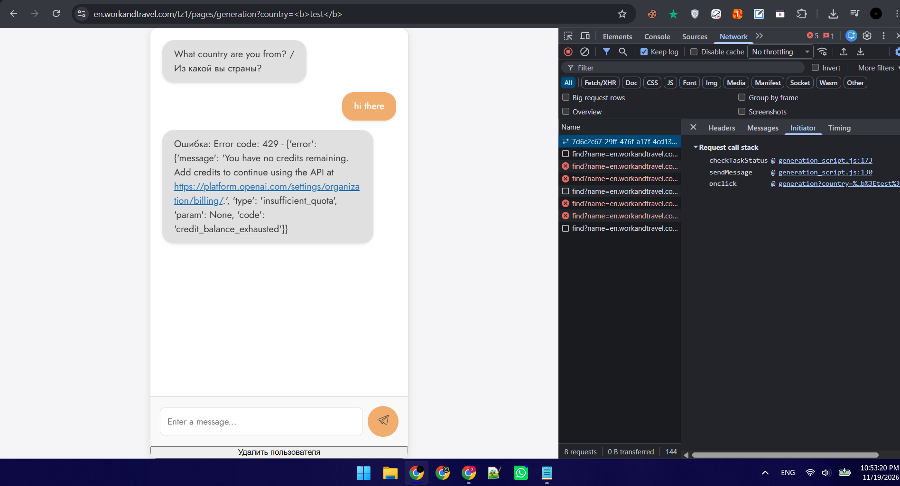
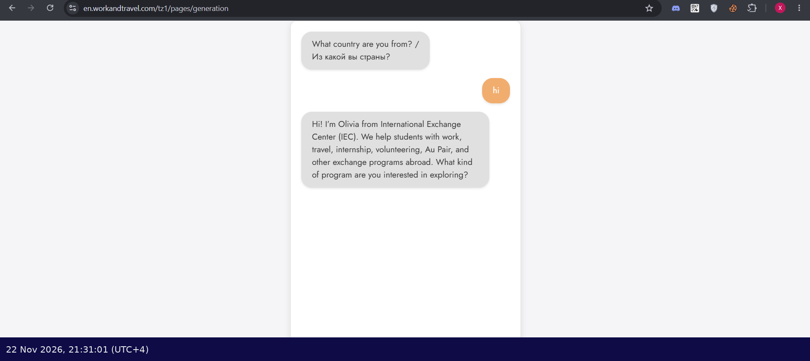

# The AI Assistant: Out of Credits, Then Refilled

The chat helper on the site ("Olivia from International Exchange Center") runs on **OpenAI**. The proof is in the error the helper showed on 19 Nov 2026 at 22:53: it points to OpenAI's billing page.

## Before: no credits (19 Nov 2026, 22:53)

I typed "hi there". Instead of an answer, the helper printed the raw error from the AI provider. In short: error 429, "You have no credits remaining", type `insufficient_quota`, code `credit_balance_exhausted`.

Image 02. Taskbar clock: 10:53 PM, 11/19/2026. The company's OpenAI credits were used up.

## After: credits refilled (22 Nov 2026, 21:31:01)

Three days later the same helper answered normally: "Hi! I'm Olivia from International Exchange Center (IEC)..."

Image 10. Time from the file name: 21:31:01 on 22 Nov 2026. So the credits were refilled sometime between these two screenshots.

| | Date and time | Screenshot | Result |
|---|---|---|---|
| Quota reached | 19 Nov 2026, 22:53 | Image 02 | Raw OpenAI error shown to the visitor |
| Working again | 22 Nov 2026, 21:31:01 | Image 10 | Normal answer from Olivia |

I do not know exactly when the refill happened, only that it was within these three days.

## What the AI parts of the API show

The public `openapi.json` is the file some people would call "the ChatGPT JSON", because it carries AI text. It still answered on 22 Nov 2026 at 20:24 and again at 22:48. On 24 Nov 2026 at 04:01:32 it answers "Not Found" ([Image 18](../assets/screenshots/18-api-description-now-not-found.png)), so the AI instruction text is no longer public there.

- A field named `qualification_prompt` has a long default instruction for the AI. In short, it tells the helper to quietly decide if a visitor is a possible lead for non-Work-and-Travel programs, and when to hand over to a human ([Image 09](../assets/screenshots/09-api-spec-ai-config-fields.png)).
- A `message_template` field holds a default follow-up message in Russian, asking if the visitor still has questions.
- Settings such as `wait_seconds` (default 172800, which is two days) and `send_delay_seconds` control follow-up timing.

I saw **no OpenAI key or other secret** in the text I read. The prompt text is business information, not a password. Still, a public file that shows how the company instructs its AI is useful to outsiders, and the raw quota error told visitors which vendor sits behind the product.

## Fair reading

Using OpenAI is normal. Running out of credits is an everyday billing event. The weak point was only that the helper showed the raw error instead of a friendly message. It is a small issue, and it went away once credits returned.
