# Discovery

This page follows the story in order. Times are UTC+4 and come from the taskbar clock in the screenshots, unless I say otherwise. Image numbers match the files in `assets/screenshots/`. Full addresses are visible in the images. Only the personal data of real people is covered.

## 1. Starting point: `robots.txt`

I opened the public `robots.txt` of workandtravel.com and followed the paths in it. I did not save the file, so I do not copy its content, and I do not know the exact time of this step. The earliest proof that I had already found the chat application is the screenshot at 22:47.

## 2. The public chat assistant

The English site has a chat widget ("Olivia from International Exchange Center"). It is meant for visitors.

<a id="image-01"></a>
**Image 01, 19 Nov 2026, 22:47.** The widget opened with a test value in its address. I wanted to see how it handles input in its parameters.

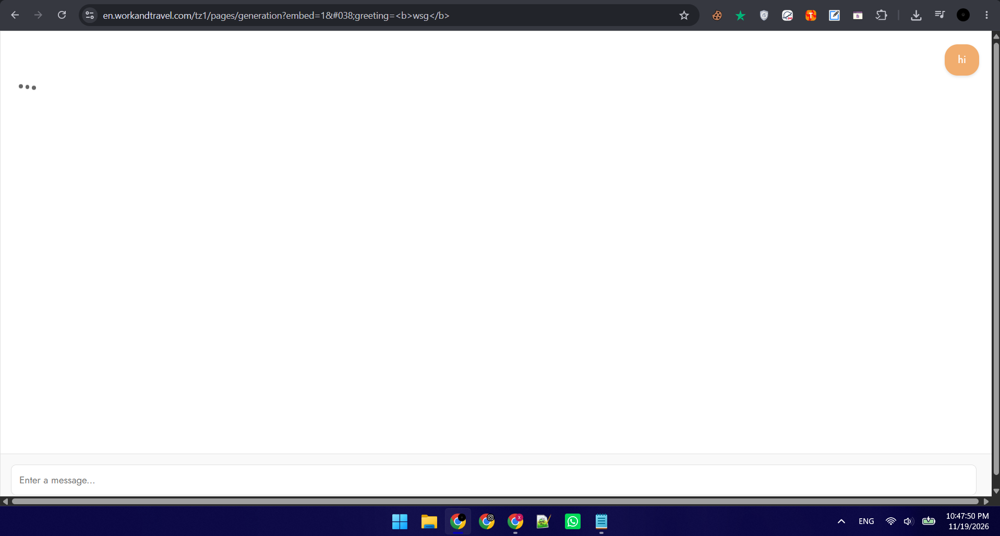

<a id="image-16"></a>
**Image 16, 19 Nov 2026, 22:51:35.** A second test. The widget printed my test text as plain characters and did not treat it as HTML. That is the safe behavior, so I found **no injection problem**.

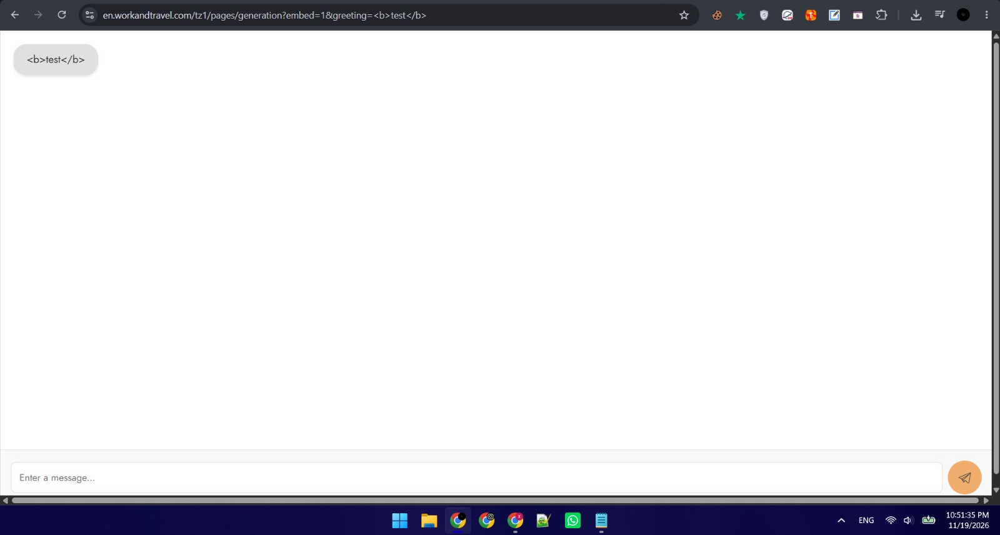

<a id="image-12"></a>
**Image 12, 19 Nov 2026, 22:51:58.** The same widget with a `country` test value. It opened normally.

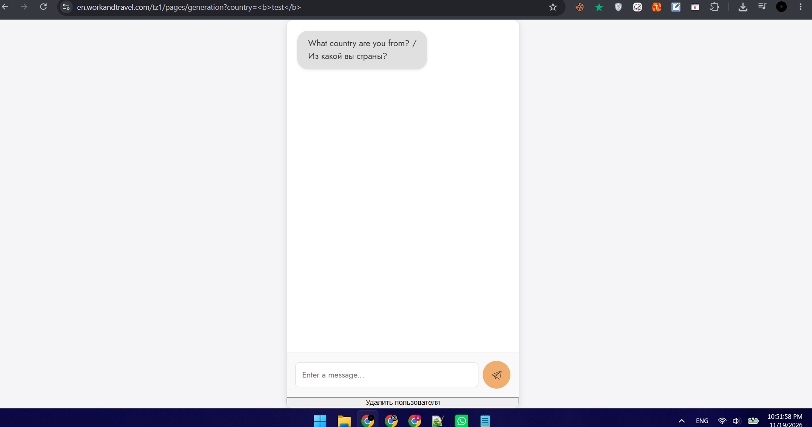

<a id="image-02"></a>
**Image 02, 19 Nov 2026, 22:53.** I sent "hi there". Instead of a reply, the chatbot showed a raw error from its AI provider: the account had **no credits left**. The error included a link to the provider's billing page.

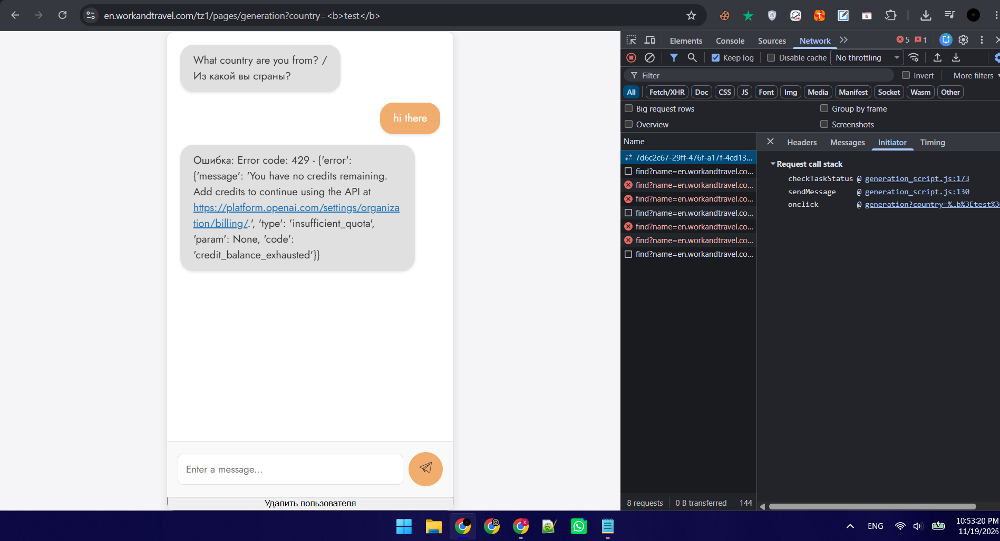

*Why it matters:* showing a vendor's raw error tells visitors which service runs behind the product. No key or password was shown. The problem was temporary, and the assistant worked again on 22 Nov 2026 at 21:31:01 ([Image 10](#image-10)). A button labelled "Удалить пользователя" ("Delete user") is visible below the widget. I did not click it.

## 3. The WordPress login page

<a id="image-03"></a>
**Image 03, 19 Nov 2026, 23:02.** The main site runs WordPress and its normal login page is reachable, like on most WordPress sites. This is **not a finding**. It is context. I hid the other browser tabs and kept only the tab named `robots.txt`, which is my only trace of the starting point.

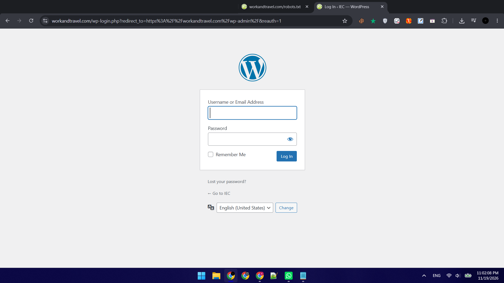

## 4. A check that came back protected

<a id="image-04"></a>
**Image 04, 19 Nov 2026, 23:09:18 (from the file name).** I asked for `/.env`, the usual place for a configuration file, to see if secrets were left open. The server answered **403 Forbidden**. This is a good result for the company.

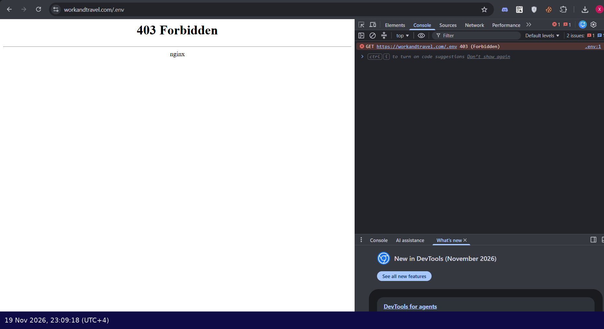

## 5. The main finding: user records on a public address

At **23:21** this address returned form logs with personal data:

```
https://workandtravel.com//wp-json/forms/v1/email-logs
```

See [Image 05 in the README](../README.md#main-finding-personal-data-on-a-public-address). I took screenshots as proof. I did not use the data in any other way.

## 6. The public API description

At **23:35** I opened a machine-readable description of the chat backend (an OpenAPI file). These files are often public on purpose, but they give anyone a full map of an application. My saved copy is 33 pages and lists about 35 paths. 

<a id="image-13"></a>
**Image 13, 19 Nov 2026, 23:35.** My first look at the API description. It starts with the list of paths, here the path for adding user data.

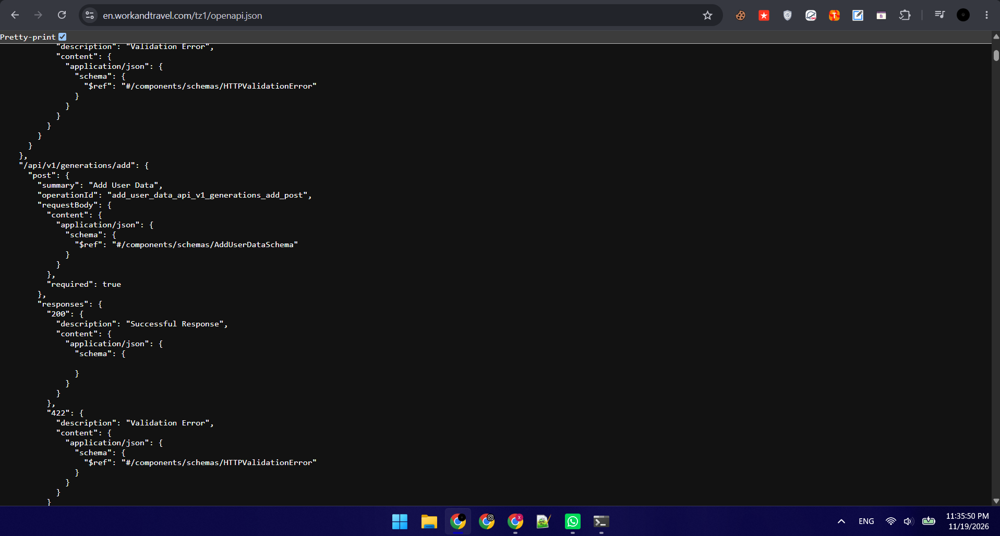

<a id="image-09"></a>
**Image 09, 22 Nov 2026, 20:24.** The file was still open. One field has a long block of AI instructions as its default value, and another has a message template.

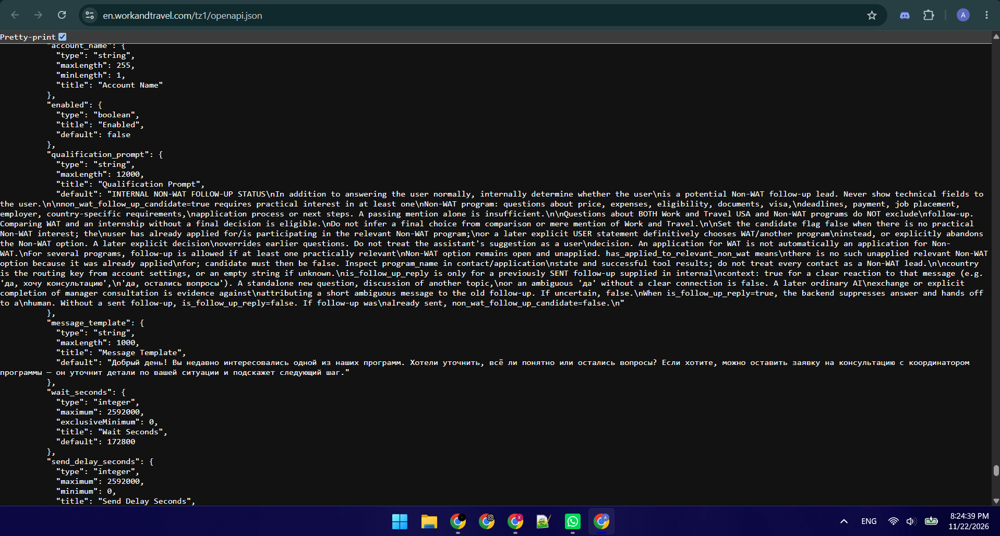

*Update:* on 24 Nov 2026 at 04:01:32 the same address answers "Not Found" ([Image 18](../assets/screenshots/18-api-description-now-not-found.png)).

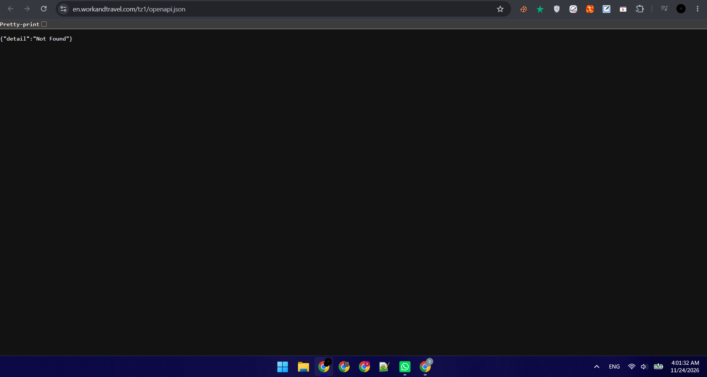

*Fair reading:* prompts inside a spec are **not a vulnerability by themselves**. I saw no keys, tokens or passwords in the text I reviewed. The concern is information disclosure: it helps outsiders understand the system, and it stayed public after the main problem was fixed.

## 7. Open lookups and protected actions

<a id="image-11"></a>
**Image 11, 22 Nov 2026, 21:34:11 (file name).** A yes/no lookup ("is this ID blocked?") answered without a login. I used a placeholder value, so the answer was *false*.

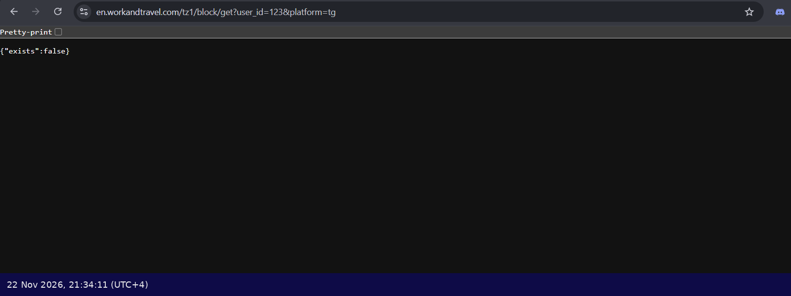

My notes from the same evening (no screenshots) say the actions that change things, such as adding or removing blocks and managing bot accounts, answered *unauthorized* or *local only*. **I did not find, and I do not claim, that anyone could do admin actions.** Three write actions gave a form error before any login result. I did not test them, because that would have created real data.

## 8. The assistant works again

<a id="image-15"></a>
**Image 15, 22 Nov 2026, 21:24:39 (file name).** The public greeting address of the chat helper answers with a short text. It is harmless and is shown only for completeness.

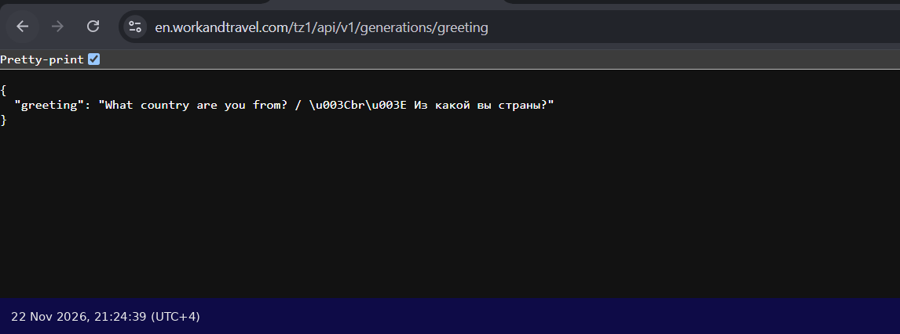

<a id="image-10"></a>
**Image 10, 22 Nov 2026, 21:31:01 (file name).** The assistant now answered normally, so the credit problem was solved.

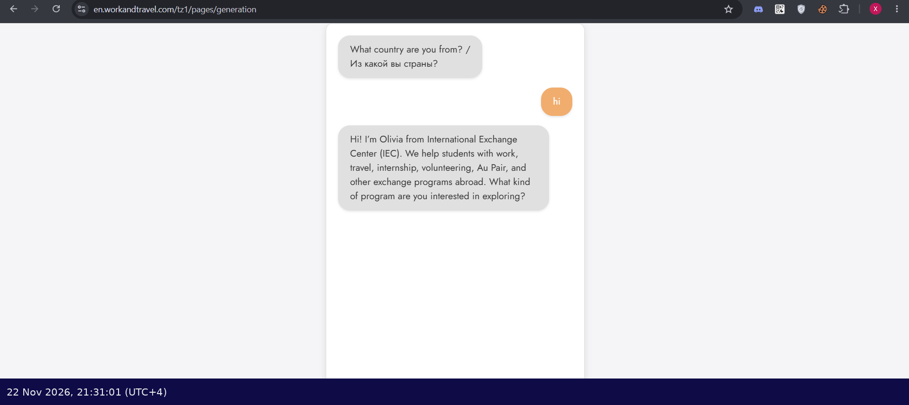

## What I did not do

According to my records, I did not try to log in, guess passwords, change data, or send real personal values. Nothing in the screenshots or notes contradicts this. The other observations are summarized in [findings.md](findings.md).
