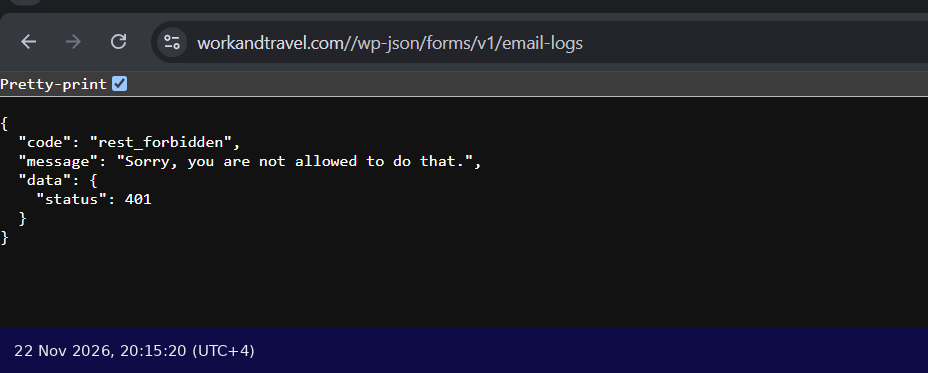
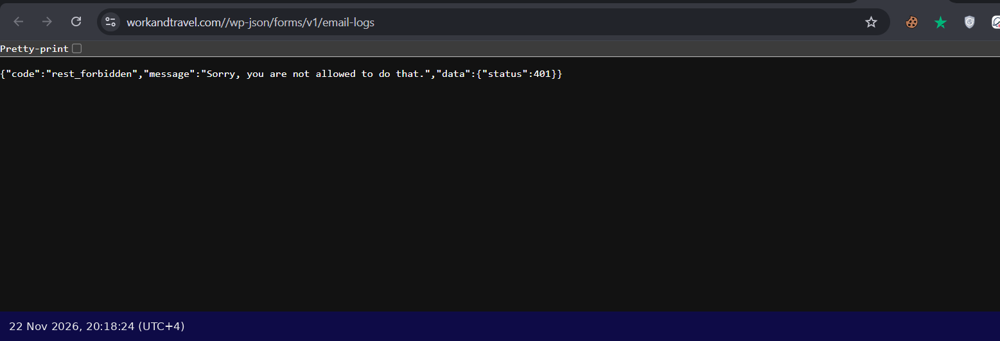
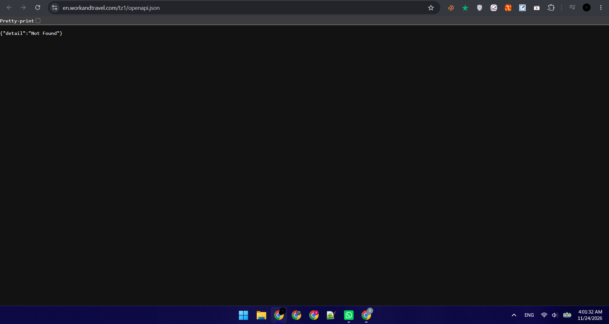

# Remediation

The same story with the emails is on the [main page](../README.md#before-report-after-the-email-log-story-back-to-back).

## Before and after

| | Before (19 Nov 2026, 23:21) | After (22 Nov 2026, 20:15 and 20:18) |
|---|---|---|
| Request to `https://workandtravel.com//wp-json/forms/v1/email-logs` | Returned a list of records with personal data | Returned *access denied*, HTTP 401 |
| Proof | [Image 05](../assets/screenshots/05-form-submissions-endpoint-redacted.png) | [Image 07](../assets/screenshots/07-after-report-access-denied.png), [Image 08](../assets/screenshots/08-after-report-access-denied-raw.png) |

This is the standard WordPress reply when a request has no permission. It is what you expect when a route is limited to logged-in administrators.

## What this proves

- The exposure I reported could no longer be read without a login on 22 Nov 2026 at 20:15, and again at 20:18.

## What it does not prove

- **When** it was fixed. The window is 20 Nov 2026, 03:28 to 22 Nov 2026, 20:15 (64 hours 47 minutes).
- **Why** it was fixed. My report is the obvious reason, and I remember about one day, but the company never said so.
- That data read by others, if any, stayed safe. I have no information about that.
- That the root cause is solved. Closing one route does not show that similar routes or older log data were checked.

## Second fix: the API description (F-02)

| | Before | After |
|---|---|---|
| Request to the API description address (`https://en.workandtravel.com/tz1/openapi.json`) | Returned the full description. Seen on 19 Nov 2026 at 23:35:50, 22 Nov 2026 at 20:24:39 and 22 Nov 2026 at 22:48 | Returns `{"detail":"Not Found"}` on 24 Nov 2026 at 04:01:32 |
| Proof | [Image 09](../assets/screenshots/09-api-spec-ai-config-fields.png), [Image 13](../assets/screenshots/13-api-description-first-view.png), saved 33-page copy | [Image 18](../assets/screenshots/18-api-description-now-not-found.png) |

- **Order of events:** my follow-up email (22 Nov 2026, 20:16), my last open check (22 Nov 2026, 22:48), then the closed address (24 Nov 2026, 04:01 at the latest).
- **Gap:** 29 hours 13 minutes between the last open check and the first closed check. The follow-up was sent 2 hours 32 minutes before the last open check, so the file stayed open for a while after the follow-up.
- **What it proves:** the description is no longer served at that address.
- **What it does not prove:** the exact fix time, why it was done, or that the app's other functions changed. I did not re-check them.

## Other observations

F-01 and F-02 are shown as closed. On 22 Nov 2026 an open lookup (F-04) was still reachable at 21:34:11, and I have not re-checked it. The chatbot error (F-03) had gone away by itself. Because of this, **I suggest not making this repo public until the remaining items are reported and fixed.** See [lessons learned](lessons-learned.md).
