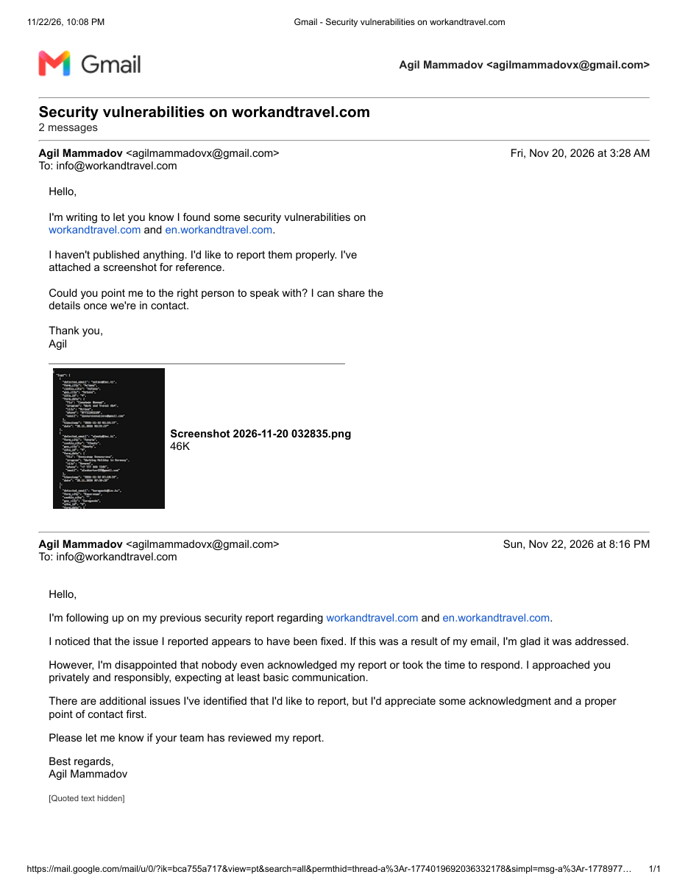
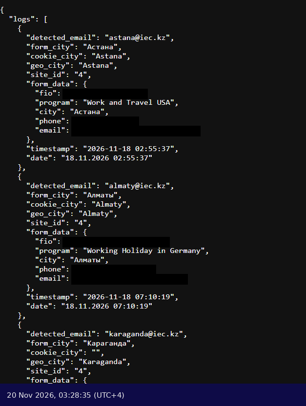
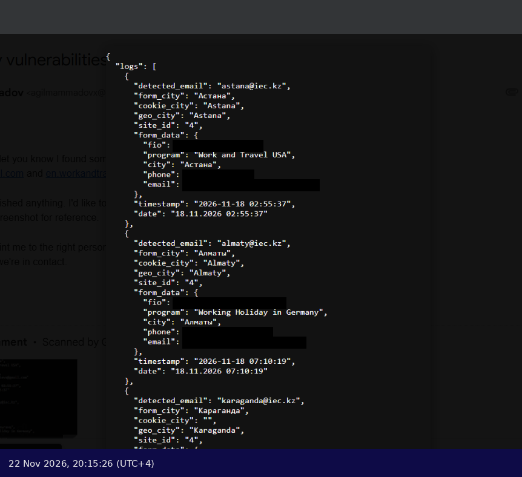

# Responsible Disclosure

## What I sent

Both emails are shown in full. The original Gmail export is in [evidence/emails/email-thread.pdf](../evidence/emails/email-thread.pdf), the full text is in [evidence/emails/email-thread.md](../evidence/emails/email-thread.md), and a picture of the export is below.

Image 17. The thread as exported from Gmail on 22 Nov 2026 at 22:08. It has two messages, both from me.

### Message 1: 20 Nov 2026, 03:28

**From:** Agil Mammadov <agilmammadovx@gmail.com>
**To:** info@workandtravel.com
**Subject:** Security vulnerabilities on workandtravel.com

> Hello,
>
> I'm writing to let you know I found some security vulnerabilities on workandtravel.com and en.workandtravel.com.
>
> I haven't published anything. I'd like to report them properly. I've attached a screenshot for reference.
>
> Could you point me to the right person to speak with? I can share the details once we're in contact.
>
> Thank you,
> Agil

**Attachment:** `Screenshot 2026-11-20 032835.png`. Here is the copy as I sent it, with personal data covered for this repo:

Image 14 shows the same attachment as I saw it in Gmail on 22 Nov 2026, which proves it was attached:

### Message 2: 22 Nov 2026, 20:16

**From:** Agil Mammadov <agilmammadovx@gmail.com>
**To:** info@workandtravel.com

> Hello,
>
> I'm following up on my previous security report regarding workandtravel.com and en.workandtravel.com.
>
> I noticed that the issue I reported appears to have been fixed. If this was a result of my email, I'm glad it was addressed.
>
> However, I'm disappointed that nobody even acknowledged my report or took the time to respond. I approached you privately and responsibly, expecting at least basic communication.
>
> There are additional issues I've identified that I'd like to report, but I'd appreciate some acknowledgment and a proper point of contact first.
>
> Please let me know if your team has reviewed my report.
>
> Best regards,
> Agil Mammadov

## What happened

| Step | Result |
|---|---|
| Report sent | Went to the general inbox (no bounce in the thread) |
| Fix | Address closed by 22 Nov 2026, 20:15. Exact date and time unknown |
| Reply | None in the thread on 22 Nov 2026 at 22:08 |
| Thanks or confirmation | None |
| Follow-up | Sent. No reply when I wrote this |
| More observations | **Not reported yet.** I asked for a contact first |
| Second change | The API description, open on 22 Nov 2026 at 22:48, answers "Not Found" on 24 Nov 2026 at 04:01 |
| Reply by 24 Nov 2026, 04:01 | **None.** I still have had no reply |

## A fair look at my own approach

**What went well:** I wrote in private, before sharing anything, and I said so. I offered to help. I kept technical details out of an open email.

**What could be better:**
- My first message did not say what or where the problem was. A busy inbox may not know who should read "I found vulnerabilities".
- I used the general info address. I did not find a security contact, and I did not look for a `security.txt` file or other channels.
- My follow-up was written right after I saw the fix and showed disappointment. It was fair, but a calm, factual version may get a reply more easily.
- I held back the other observations. That was careful, but it means some items are still open and unreported.

## Update, 24 Nov 2026, 04:01

After my follow-up, the API description I had offered to report was also closed. The company still has not written to me. So now two of the things I saw were fixed, and I have had no acknowledgment for either. I do not know whether my emails caused the changes.

## About the silence

I do not know why there was no reply. The inbox may be unwatched, the email may have been filtered, the fix may have been made by someone who never saw it, or the team may have no disclosure process. None of this is a judgment of their intent. The effect is clear, though: without a reply I cannot confirm they got my report, give credit, or know if I should report the rest.

## A better way to report

1. Look for a security contact first.
2. Say the *type* of problem, the *general area* and the *kind of data*. Do not give steps to repeat it.
3. Send as little sensitive proof as possible, or cover it.
4. Set a polite check-in date and follow up once with facts.
5. Do not publish details until it is fixed and the company has had a fair chance to answer.
