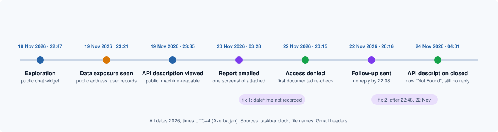

# Timeline

All times are **UTC+4** (Azerbaijan). I checked the clock two ways: the Gmail export shows my local send times, and a PDF I printed on 22 Nov 2026 at 22:48 has a creation time of 18:48 UTC. Those match UTC+4.

**Time sources:** *Clock* means the Windows taskbar clock in a screenshot (most reliable). *File name* means the Windows screenshot name (reliable). *Gmail* means the email header. WhatsApp file names show when I sent an image to my phone, so I do **not** use them as event times.

| Date | Time | Event | Source | Proof |
|---|---|---|---|---|
| 18 Nov 2026 | 02:28 to 07:10 | Timestamps inside the records I later saw (not my activity) | Record fields | Images 05, 06 |
| 19 Nov 2026 | unknown | Opened public `robots.txt` and followed paths. Time not saved. Before 23:02 | Tab title | Image 03 |
| 19 Nov 2026 | 22:47 | Chat widget opened with a test parameter | Clock | Image 01 |
| 19 Nov 2026 | 22:51 | Second test. Text shown as plain characters | Clock | Image 16 |
| 19 Nov 2026 | 22:53 | Chatbot shows raw AI quota error | Clock | Image 02 |
| 19 Nov 2026 | 23:02 | WordPress login page seen (context only) | Clock | Image 03 |
| 19 Nov 2026 | 23:09:18 | `/.env` request denied (403) | File name | Image 04 |
| 19 Nov 2026 | **23:21** | **`/wp-json/forms/v1/email-logs` returned form data with personal details** | Clock | Image 05 |
| 19 Nov 2026 | 23:35 | API description opened | Clock | Image 13 |
| 20 Nov 2026 | **03:28** | **First report emailed** with one screenshot | Gmail | Image 06 |
| 20 Nov 2026 03:28 to 22 Nov 2026 20:15 | not recorded | The address was closed. I think about one day later. Not recorded | n/a | n/a |
| 22 Nov 2026 | **20:15** | **Same address says 401 access denied** (first check on record) | File name | Image 07 |
| 22 Nov 2026 | 20:16 | **Follow-up emailed** | Gmail | [Thread](responsible-disclosure.md) |
| 22 Nov 2026 | 20:18 | Second check, same result | File name | Image 08 |
| 22 Nov 2026 | 20:24 | API description still open | Clock | Image 09 |
| 22 Nov 2026 | 21:31:01 | Chat assistant works again | File name | Image 10 |
| 22 Nov 2026 | 21:34:11 | Open lookup still answers | File name | Image 11 |
| 22 Nov 2026 | 22:08 | Email thread shows two messages, both mine | Gmail print | [Image 17](../assets/screenshots/17-email-thread-gmail-export.png) |
| 22 Nov 2026 | 22:48 | API description saved to PDF, still open | PDF metadata | Saved copy |
| 22 Nov 2026 to 24 Nov 2026 | 22:48 to 04:01 | The API description is closed. Exact time not recorded | n/a | n/a |
| 24 Nov 2026 | **04:01:32** | **API description address answers "Not Found".** I still have had no reply | Clock | [Image 18](../assets/screenshots/18-api-description-now-not-found.png) |

## What this shows and what it does not

- **Shows:** I saw the exposure on 19 Nov 2026 at 23:21, reported it about four hours later, and it was closed by 20:15 on 22 Nov 2026, at most 64 hours 47 minutes after my report.
- **Also shows:** the API description was open at 22:48 on 22 Nov 2026 and closed by 04:01 on 24 Nov 2026, at most 29 hours 13 minutes later, and after my follow-up email.
- **Does not show:** the exact fix times, whether my report caused the fix, or whether the company read my email. "About a day" is my memory, not a record.
